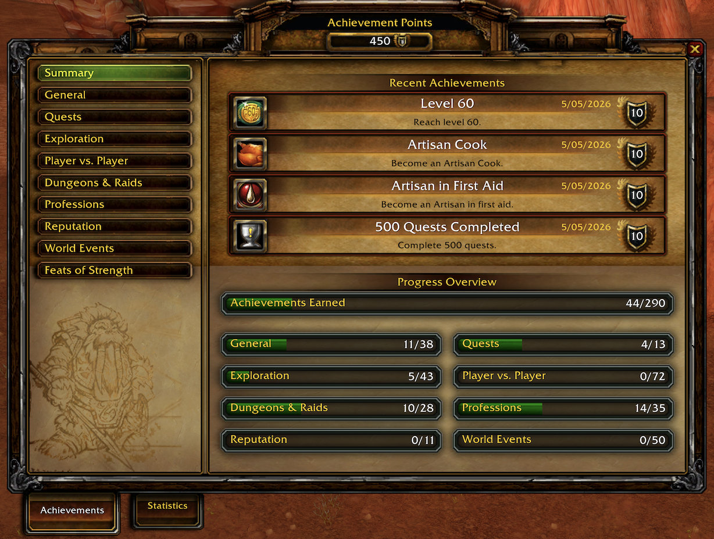
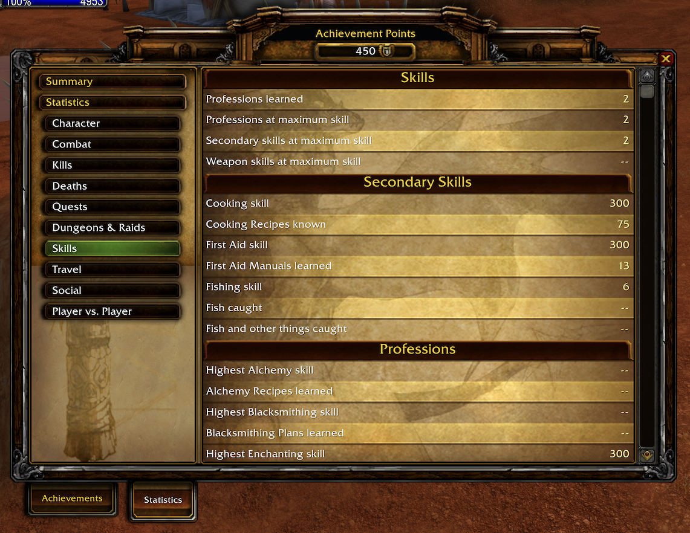
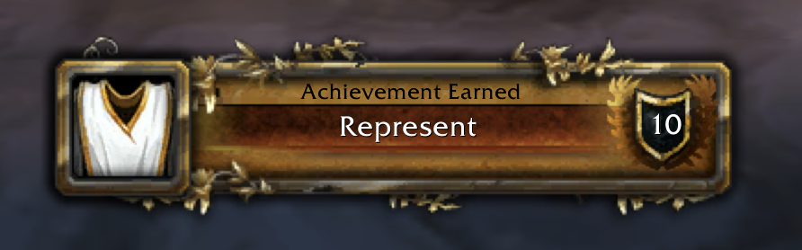
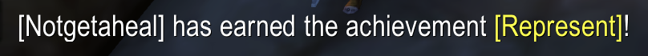
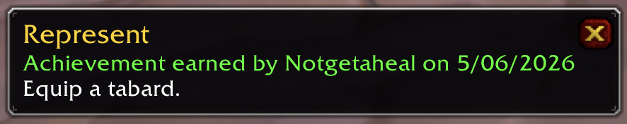
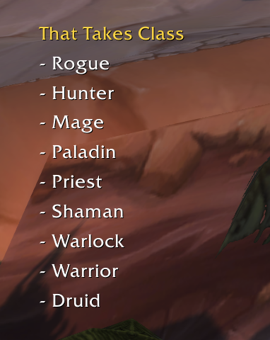
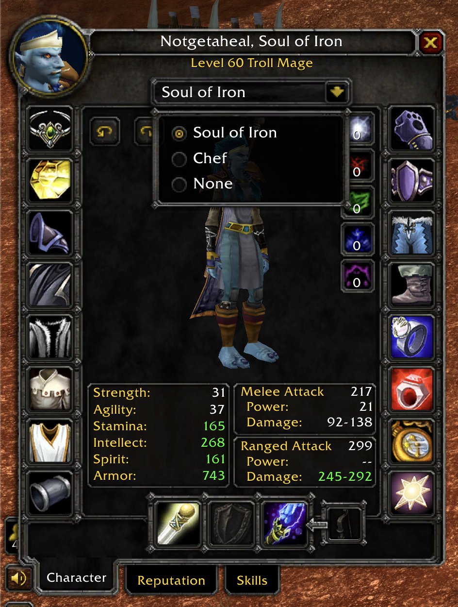

# Achievements

Achievements brings a Blizzard-style achievement system to World of Warcraft Classic Era, The Burning Crusade and World of Warcraft: Forever clients. It adds the achievement frame, statistics, achievement tracking, completion toasts, chat links, title rewards, social comparison, and a compatibility API for other addons.

## Supported Clients

- Classic Era (`11509`)
- The Burning Crusade / Anniversary (`20506`)
- World of Warcraft: Forever (`16001`)

All clients use achievement UI files bundled with the addon (a per-client copy under `Vanilla/`, `TBC/` and `Forever/`). On Classic Era and The Burning Crusade the native load-on-demand `Blizzard_AchievementUI` addon is never loaded: on Classic Era the client blocks it, and on The Burning Crusade loading it from an addon taints Blizzard's protected code and blocks logging out. A chat warning is shown there if another addon force-loads `Blizzard_AchievementUI`. On Forever, Blizzard's own achievement window stays available next to the bundled one (see [World of Warcraft: Forever](#world-of-warcraft-forever)).

## Required Addons

Supported clients: Classic Era (1.15), The Burning Crusade Anniversary (2.5) and World of Warcraft: Forever (1.60). On Forever the addon uses its own Forever data set; see [World of Warcraft: Forever](#world-of-warcraft-forever) for the current limitations.

Achievements ships as two addon folders:

- `Achievements` is the runtime addon. It contains the UI integration, achievement API, tracking, saved progress, chat links, networking, comparison, guild announcements, title support, and compatibility fixes.
- `AchievementsData` is the required generated data addon. It contains the achievement database, categories, criteria, statistics, title data, localizations, and fallback icon assets.

Install both folders side by side:

```text
Interface/AddOns/Achievements
Interface/AddOns/AchievementsData
```

The bundled release zip (Wago, WoWInterface, GitHub) includes both folders. The CurseForge `Achievements` download carries a copy of the data inside `Achievements/Data/`, so it works on its own; installing the separate `AchievementsData` package next to it is still recommended because that package receives data updates independently; when both are present the newest installed copy is used. The plain `Achievements` zip on GitHub expects `AchievementsData` to be installed beside it and cannot load without it, because it has no achievement data to display or evaluate. `/ach versions` shows which data copy is in use.

## Quick Start

- Open Achievements from the micro button or with the default keybinding `Y` (`SHIFT-Y` on Forever).
- Open Statistics with `SHIFT-Y` (`CTRL-Y` on Forever).
- Shift-click an achievement while a chat box is open to insert a clickable achievement link.
- Use the normal quest-watch tracking modifier on an achievement to track or untrack it on screen.
- Right-click another friendly player and choose `Compare Achievements`, or type `/ach-compare PlayerName`.
- Select earned achievement title rewards from the Character frame title dropdown, or use `/ach-title`.

## Screenshots

**Achievement Summary**



**Statistics**



**Achievement Earned Toast**



**Chat Announcement**



**Clickable Achievement Link**



**Tracked Objectives**



**Title Selection**



## Features

- **Blizzard-style achievement UI**: achievement categories, points, completion dates, criteria, rewards, summary views, and statistics in a familiar frame.
- **Classic, TBC and Forever data sets**: client-specific generated data for achievements, categories, criteria trees, statistics, quests, maps, reputations, factions, items, spells, skills, emotes, titles, and localizations.
- **Saved progress**: local character progress for supported Classic/TBC criteria, with account-wide storage reserved for account-wide achievement state and shared remote snapshots.
- **Completion feedback**: achievement toasts, local chat output, and addon-message achievement broadcasts visible to nearby or guild players running the addon.
- **Achievement tracking**: track incomplete achievements in a lightweight watch frame that updates alongside the quest tracker.
- **Clickable chat links**: achievement links work in Classic chat channels even on clients that normally strip unsupported achievement hyperlinks.
- **Player comparison**: compare achievements and statistics with another player running the addon through the right-click player menu or `/ach-compare`.
- **Armory-style snapshots**: fetch and store achievement snapshots from a player or from addon users in the hidden achievements channel with `/ach-fetch`.
- **Achievement title rewards**: earned title rewards can be selected from the Character frame or `/ach-title`; selected addon titles are shared with nearby addon users through group, guild, and addon-channel messages.
- **Retail-style API compatibility**: exposes familiar functions such as `GetAchievementInfo`, `GetAchievementCriteriaInfo`, `GetAchievementLink`, `GetStatistic`, `AddTrackedAchievement`, `RemoveTrackedAchievement`, comparison APIs, and achievement frame toggles for addon compatibility. On Forever these globals stay Blizzard's native API and the addon's versions are available as `Achievements.<name>`.
- **Data-only updates**: generated data and icon updates can be released through `AchievementsData` without replacing the runtime addon.

## Slash Commands

| Command | Description |
| --- | --- |
| `/ach locale` | Show the selected and effective achievement-data locale and list the available locale codes. |
| `/ach locale <code>` | Display generated achievement content in any locale available from the installed `AchievementsData` package, then reload the interface. |
| `/ach locale auto` | Return to the WoW client locale and reload the interface if the selection changes. |
| `/ach-compare <name>` | Compare achievements and statistics with another player running the addon. |
| `/ach-fetch` or `/ach-fetch channel` | Request achievement snapshots from addon users in the hidden achievements channel. |
| `/ach-fetch player <name>` | Request a snapshot from one player. |
| `/ach-fetch show` | Show a summary of stored remote snapshots. |
| `/ach-fetch clear` | Clear stored remote snapshots. |
| `/ach-title` | List available earned title rewards. |
| `/ach-title <number>` | Select a title from the `/ach-title` list. |
| `/ach-title none` | Clear the selected addon title. |

Support/debug commands also exist for troubleshooting, but they are not needed for normal play.

## Data and Localization

The companion `AchievementsData` addon is generated from 3.4.5.63697 data (plus Forever's own game tables for World of Warcraft: Forever) and filtered for the supported clients:

- Classic Era: 383 achievements and 177 statistics.
- The Burning Crusade: 643 achievements and 254 statistics.
- Included localizations: `deDE`, `esES`, `esMX`, `frFR`, `koKR`, `ptBR`, `ruRU`, `zhCN`, and `zhTW`.

Runtime localization overlays are applied from `AchievementsData` based on your game client locale. Use `/ach locale <code>` to override that choice with any locale available in the installed data package, or `/ach locale auto` to restore automatic selection. The account-wide selection applies to every character and persists across sessions. A successful selection change reloads the interface. If the selected client locale has no available overlay, the generated English (`enUS`) base data is used.

The override only affects generated achievement content, such as achievement names, descriptions, criteria, categories, and rewards. Blizzard-owned window labels, tabs, buttons, tooltips, and date formats remain in the WoW client language. Missing fields in a partial localization continue to use the English base data.

Achievement tracking is unaffected by the override. Where the addon has to match generated text against text the game client produces, such as skill and profession names, battleground zone and faction names, readable-object titles, targeted emote names, and incoming achievement chat links, it always matches against the client-language text.

## World of Warcraft: Forever

Forever (interface `16001`) runs the Mainline (retail) API rather than the Classic one. There is no separate Forever manifest: the Forever-only lines in the shared `Achievements.toc` are gated with `[AllowLoadGameType camelot][ExcludeLoadGameType standard, classic]` because older clients do not know the `camelot` game type and would otherwise load them. On Forever the manifest loads `AchievementsForeverCompat.lua` first to restore the Classic-era functions the addon calls (item, spell, aura, reputation, skill and quest lookups), then the regular addon files, `AchievementsForeverCriteria.lua` (the Forever replacement for the combat-log driven tracking, see below) and the `Forever/` copy of the bundled achievement window. Forever has its own generated data set, `AchievementsData_Camelot.lua`, built from Forever's game tables with the Classic Era achievement definitions; quest zone data comes from QuestieDB's Forever database, which is currently a converted Classic Era baseline, so quests that only exist on Forever are not yet counted by zone-based quest criteria.

Forever's Legacy system is built on Blizzard's own achievement API and achievement window, so on Forever the addon leaves those untouched: it does not replace the native achievement functions, and its bundled window is fully namespaced so both can be open in the same session. The default keys move up one modifier there because Blizzard binds `Y` to the Legacy window: the addon's shipped `Y` default would take that key, so a one-time migration moves it to `SHIFT-Y` for achievements and `CTRL-Y` for statistics and gives `Y` back to the Legacy window (once per binding set, and only while the addon's bindings are still at their shipped defaults, the Legacy window has no key and `CTRL-Y` is free). The achievement micro button sits in the micro menu as on other clients, and `/ach` works as usual.

Known limitations:

- Forever closes the combat log to addons, so the addon tracks combat criteria from other signals instead: creature kills from encounter results, from tapped creatures it can see dying (target, focus, their targets, mouseover, nameplates), from looted corpses and from experience-gain messages; honorable kills from honor-gain messages; spells you cast from your own cast events; damage dealt and healing done from Blizzard's damage meter after each fight; damage and healing taken from your own combat text; and deaths to creatures, players or the environment from the death recap. Kills credited from a name-only signal count once per creature name within a few seconds, so AoE farming of identical mobs can undercount.
- Still not trackable on Forever: killing blows (including killing blows by class or race), the longest fall survived, the largest single hit dealt and largest heal cast, and "spell cast on you" criteria that are not auras (resurrections). These stay at their saved progress.
- Arena team and PvP rank criteria have no Forever equivalent yet and stay unresolved.

## Community

Join our community on [Discord](https://discord.gg/TrJFGcah7z) for support, bug reports, and feedback.

## Notes and Limitations

- This addon is a local Classic achievement system. It is not Blizzard's account-wide Retail achievement service.
- Progress depends on what the Classic client exposes through APIs, events, chat messages, saved variables, and generated data. Some achievements can be backfilled from current character state, while others only progress after the addon observes the relevant event.
- Social comparison, remote snapshots, title sharing, and guild achievement messages require other players to run a compatible version of the addon.
- Keep `Achievements` and `AchievementsData` from the same release whenever possible so runtime behavior and generated data stay in sync.

## Package Notes

- `Achievements` contains runtime Lua, bindings, UI integration, bundled Classic achievement UI files, media, saved-variable handling, and compatibility APIs.
- `AchievementsData` contains generated Lua data files and icon assets. It does not provide UI by itself.
- Both packages are released under the GNU GPL3 license.
